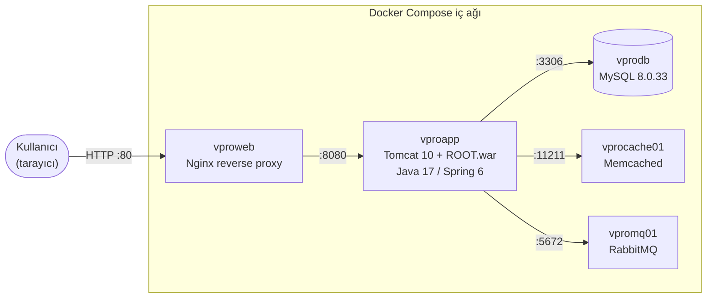
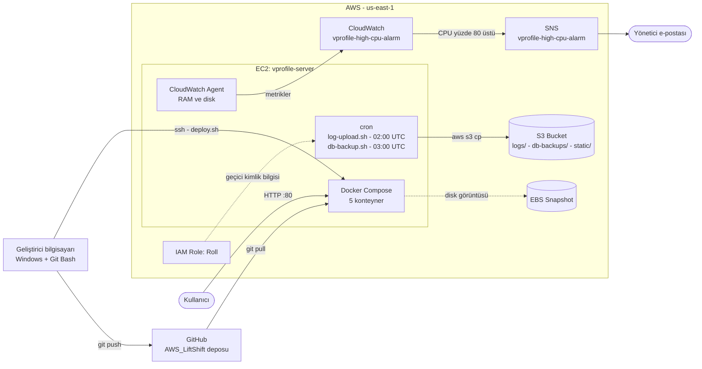
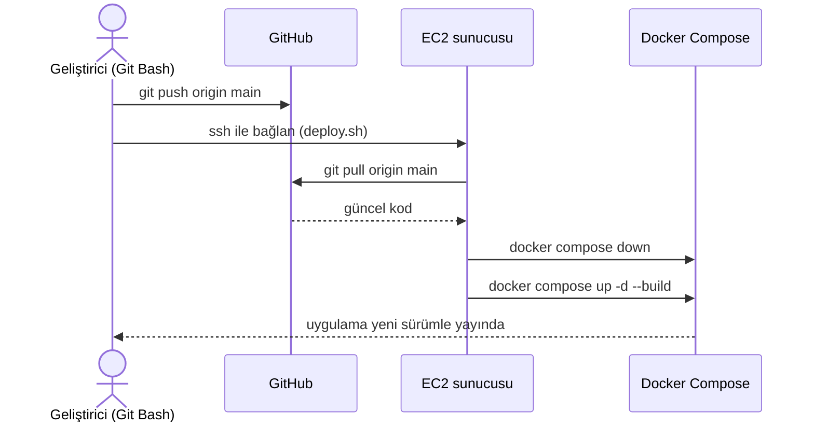

# vprofile - Docker ile Konteynerizasyon ve AWS EC2 Üzerinde Lift & Shift

Bu proje, Java tabanlı çok katmanlı bir web uygulaması olan **vprofile**'ı Docker konteynerlerine taşımayı, ardından tek bir AWS EC2 sunucusunda çalıştırmayı ve bu sunucunun log yönetimini, izlemesini, yedeklemesini ve deploy sürecini otomatikleştirmeyi kapsar.

"Lift & Shift" yaklaşımında uygulamanın kodu yeniden yazılmaz. Uygulama olduğu gibi yeni bir altyapıya taşınır. Bu projede taşıma iki adımda yapıldı: önce yerel ortamdan Docker konteynerlerine, sonra Docker konteynerleriyle birlikte AWS bulutuna.

Kaynak uygulama: [hkhcoder/vprofile-project](https://github.com/hkhcoder/vprofile-project)

---

## İçindekiler

1. [Proje Yol Haritası](#1-proje-yol-haritası)
2. [Mimari](#2-mimari)
3. [Altyapı Bilgileri](#3-altyapı-bilgileri)
4. [Aşama 1a - Uygulamanın Konteynerize Edilmesi](#4-aşama-1a---uygulamanın-konteynerize-edilmesi)
5. [Aşama 1b - EC2 Sunucusuna Taşıma ve Elle Deploy](#5-aşama-1b---ec2-sunucusuna-taşıma-ve-elle-deploy)
6. [Aşama 2 - S3 Depolama ve CloudWatch İzleme](#6-aşama-2---s3-depolama-ve-cloudwatch-izleme)
7. [Aşama 3 - Deploy Otomasyonu ve Yedekleme](#7-aşama-3---deploy-otomasyonu-ve-yedekleme)
8. [Karşılaşılan Sorunlar ve Çözümleri](#8-karşılaşılan-sorunlar-ve-çözümleri)
9. [Kullanılan Teknolojiler ve Araçlar](#9-kullanılan-teknolojiler-ve-araçlar)
10. [Sonuç ve Kazanımlar](#10-sonuç-ve-kazanımlar)
11. [Geliştirilebilecek Noktalar](#11-geliştirilebilecek-noktalar)
12. [Kaynakların Temizlenmesi](#12-kaynakların-temizlenmesi)

---

## 1. Proje Yol Haritası

| Aşama | Kapsam | Durum |
|---|---|---|
| 1a | Uygulamayı Docker ile konteynerize etmek ve yerelde çalıştırmak | Tamamlandı |
| 1b | Docker projesini tek bir EC2 sunucusuna taşıyıp elle deploy etmek | Tamamlandı |
| 2 | S3 ile log ve statik dosya depolama, CloudWatch ile metrik takibi ve alarm | Tamamlandı |
| 3 | Tek komutla deploy betiği, veritabanı yedekleme ve EBS snapshot | Tamamlandı |

---

## 2. Mimari

### 2.1 Uygulama mimarisi

vprofile beş servisten oluşur. Her servis kendi konteynerinde çalışır. Servisler, Docker Compose'un oluşturduğu ortak bir iç ağ üzerinden birbirleriyle **isim üzerinden** haberleşir.



| Servis | İmaj | Görevi |
|---|---|---|
| `vproweb` | nginx (özel imaj) | Dış dünyaya açılan tek kapı. Gelen istekleri uygulamaya yönlendirir. |
| `vproapp` | tomcat:10-jdk17 (özel imaj) | Java uygulamasını (`ROOT.war`) çalıştırır. |
| `vprodb` | mysql:8.0.33 (özel imaj) | Kullanıcı bilgilerinin tutulduğu `accounts` veritabanı. |
| `vprocache01` | memcached | Veritabanı sorgularını önbelleğe alarak hızlandırır. |
| `vpromq01` | rabbitmq | Mesaj kuyruğu servisi. |

Dışarıya yalnızca Nginx'in 80 portu açıktır. Uygulama, veritabanı, önbellek ve kuyruk servisleri sadece Docker'ın iç ağından erişilebilir.

### 2.2 AWS mimarisi



---

## 3. Altyapı Bilgileri

| Bileşen | Değer |
|---|---|
| AWS bölgesi | `us-east-1` (Kuzey Virginia) |
| EC2 sunucusu | `vprofile-server` (t3.small, 2 vCPU, 2 GB RAM) |
| Disk | 20 GB EBS |
| İşletim sistemi | Ubuntu, kullanıcı: `ubuntu` |
| Statik IP | Elastic IP |
| Security Group | `vprofile-sg` |
| Key Pair | `vprofile-key2` |
| S3 bucket | `vprofile-sena-101-<HESAP_ID>-us-east-1-an` |
| IAM rolü | `Roll` (EC2 Instance Profile), bağlı politika: `vprofile-s3-policy` |
| SNS konusu | `vprofile-high-cpu-alarm` |
| CloudWatch alarmı | `vprofile-high-cpu-alarm` |
| EBS snapshot | `vprofile-server-final-snapshot` |
| Uygulama | Docker Compose: `vproapp`, `vprodb`, `vproweb`, `vprocache01`, `vpromq01` |

AWS hesap numarası, instance ID ve IP adresleri bilinçli olarak bu dokümana yazılmamıştır. Bu bilgiler tek başına erişim sağlamaz ama herkese açık bir depoda paylaşılmaları saldırı yüzeyini büyütür.

---

## 4. Aşama 1a - Uygulamanın Konteynerize Edilmesi

### 4.1 Kaynak kodun alınması

vprofile uygulamasının kaynak kodu (`src/`, `pom.xml`) hkhcoder/vprofile-project deposundan alındı. Uygulama Spring 6 ve Jakarta EE kullanan, Maven ile derlenen bir Java 17 projesidir. Derlendiğinde `vprofile-v2.war` dosyası üretir.

### 4.2 Uygulama ayarlarının konteyner ortamına uyarlanması

`src/main/resources/application.properties` dosyasında, uygulamanın bağlandığı servislerin adresleri Docker Compose servis adlarıyla aynı olacak şekilde düzenlendi:

```properties
jdbc.url=jdbc:mysql://vprodb:3306/accounts?...
jdbc.username=root
jdbc.password=vprodbpass

memcached.active.host=vprocache01
rabbitmq.address=vpromq01
```

**Neden önemli:** Docker Compose, aynı dosyada tanımlanan servisleri ortak bir ağa bağlar ve her servisin adını bir DNS kaydı gibi çözer. Uygulama `vprodb` adresine bağlanmak istediğinde Docker bu ismi otomatik olarak MySQL konteynerinin IP adresine çevirir. Konteyner yeniden oluşturulup IP adresi değişse bile bağlantı bozulmaz.

### 4.3 Dockerfile'lar

Her özel servis için `Docker-files/` altında ayrı bir klasör ve Dockerfile oluşturuldu.

**`Docker-files/app/Dockerfile` - Uygulama (multi-stage build)**

```dockerfile
FROM maven:3.9.9-eclipse-temurin-17 AS build
WORKDIR /src
COPY pom.xml .
COPY src ./src
RUN mvn -q package -DskipTests

FROM tomcat:10-jdk17
RUN rm -rf /usr/local/tomcat/webapps/*
COPY --from=build /src/target/vprofile-v2.war /usr/local/tomcat/webapps/ROOT.war
EXPOSE 8080
CMD ["catalina.sh", "run"]
```

- **Birinci aşama (build):** Maven imajı içinde kaynak kod derlenir ve `.war` dosyası üretilir. Bilgisayarda veya sunucuda Maven ya da JDK kurulu olmasına gerek kalmaz.
- **İkinci aşama:** Sadece Tomcat imajı alınır ve derlenmiş `.war` dosyası içine kopyalanır. Maven, kaynak kod ve derleme artıkları son imaja girmez. İmaj hem küçülür hem de daha güvenli olur.
- `.war` dosyası `ROOT.war` olarak kopyalandığı için uygulama doğrudan kök adreste (`/`) açılır.
- **Neden Tomcat 10:** Kod `jakarta.*` paketlerini kullanıyor. Tomcat 9 ve öncesi eski `javax.*` paketlerini desteklediği için bu uygulamayı çalıştıramaz.

**`Docker-files/db/Dockerfile` - Veritabanı**

```dockerfile
FROM mysql:8.0.33
ENV MYSQL_DATABASE="accounts"
COPY db_backup.sql /docker-entrypoint-initdb.d/db_backup.sql
```

- `MYSQL_DATABASE` ile konteyner ilk açıldığında `accounts` veritabanı otomatik oluşturulur.
- Resmi MySQL imajı, `/docker-entrypoint-initdb.d/` klasörüne konan `.sql` dosyalarını ilk açılışta otomatik çalıştırır. Tablolar ve örnek kullanıcı (`admin_vp`) elle müdahale olmadan yüklenir.
- Bu betik yalnızca veri klasörü boşken çalışır. Volume'da veri varsa tekrar çalışmaz.

**`Docker-files/web/Dockerfile` ve `nginvproapp.conf` - Nginx**

```dockerfile
FROM nginx
RUN rm -f /etc/nginx/conf.d/default.conf
COPY nginvproapp.conf /etc/nginx/conf.d/vproapp.conf
```

```nginx
upstream vproapp {
  server vproapp:8080;
}
server {
  listen 80;
  location / {
    proxy_pass http://vproapp;
  }
}
```

Nginx **reverse proxy** olarak çalışır. Kullanıcıdan 80 portundan gelen isteği, iç ağdaki `vproapp` konteynerinin 8080 portuna iletir. Kullanıcı Tomcat ile doğrudan konuşmaz.

### 4.4 Docker Compose

```yaml
services:
  vprodb:
    build: ./Docker-files/db
    environment:
      - MYSQL_ROOT_PASSWORD=vprodbpass
    volumes:
      - vprodbdata:/var/lib/mysql
    restart: always

  vprocache01:
    image: memcached
    restart: always

  vpromq01:
    image: rabbitmq
    environment:
      - RABBITMQ_DEFAULT_USER=guest
      - RABBITMQ_DEFAULT_PASS=guest
    restart: always

  vproapp:
    build:
      context: .
      dockerfile: Docker-files/app/Dockerfile
    depends_on:
      - vprodb
      - vprocache01
      - vpromq01
    restart: always

  vproweb:
    build: ./Docker-files/web
    ports:
      - "80:80"
    depends_on:
      - vproapp
    restart: always

volumes:
  vprodbdata: {}
```

Önemli kararlar:

- **`vprodbdata` volume'u:** MySQL verisi konteynerin dışında, Docker'ın yönettiği kalıcı bir alanda saklanır. Konteyner silinse ya da yeniden oluşturulsa bile veri kaybolmaz.
- **`vproapp` için `context: .`:** Uygulama imajı derlenirken `pom.xml` ve `src/` klasörüne erişmesi gerektiği için build bağlamı proje kök dizini olarak verildi.
- **`depends_on`:** Servislerin başlama sırasını belirler.
- **`restart: always`:** `depends_on` yalnızca başlama sırasını garanti eder, servisin hazır olmasını beklemez. MySQL geç açılırsa uygulama ilk denemede bağlanamayıp kapanabilir. `restart: always` sayesinde uygulama otomatik olarak yeniden başlar ve veritabanı hazır olduğunda bağlanır.
- **Sadece `vproweb` için port yayınlandı:** Diğer servisler dışarıya kapalıdır.

### 4.5 Yerelde test

Docker Desktop üzerinde imajlar derlendi ve sistem ayağa kaldırıldı:

```bash
docker compose up -d --build
docker compose ps
docker compose logs -f vproapp
```

Uygulamaya `http://localhost` adresinden erişilir. Varsayılan giriş bilgileri: `admin_vp` / `admin_vp`.

```bash
docker compose down        # konteynerleri kaldırır, veri volume'u korunur
docker compose down -v     # veri volume'unu da siler (veritabanı sıfırlanır)
```

---

## 5. Aşama 1b - EC2 Sunucusuna Taşıma ve Elle Deploy

Yerelde çalıştığı doğrulanan Docker projesi, `us-east-1` bölgesinde oluşturulan `vprofile-server` adlı Ubuntu EC2 sunucusuna taşındı.

Yapılanlar:

1. EC2 sunucusu oluşturuldu ve SSH anahtar çifti (`.pem`) ile erişim sağlandı.
2. Security Group üzerinde SSH (22) ve HTTP (80) portlarına izin verildi.
3. Sunucuya Docker Engine ve Docker Compose eklentisi kuruldu.
4. Proje GitHub'dan sunucuya `git clone` ile çekildi.
5. `docker compose up -d --build` ile beş konteyner sunucu üzerinde derlenip başlatıldı.
6. Sunucuya bir Elastic IP bağlandı. Böylece sunucu durdurulup yeniden başlatıldığında IP adresi değişmez.
7. Uygulamaya bu IP adresi üzerinden, port 80'den tarayıcıyla erişildi.

Bu aşamada uygulama koduna veya Docker dosyalarına hiçbir değişiklik yapılmadı. Yerelde çalışan yapı, sunucuda da aynı şekilde çalıştı. Konteynerizasyonun sağladığı taşınabilirliğin pratik karşılığı budur.

---

## 6. Aşama 2 - S3 Depolama ve CloudWatch İzleme

### 6.1 S3 bucket yapısı

Loglar, veritabanı yedekleri ve statik dosyalar için bir S3 bucket oluşturuldu. Bucket içinde üç ayrı klasör (prefix) tanımlandı:

```
vprofile-sena-101-<HESAP_ID>-us-east-1-an/
├── logs/          # Günlük konteyner logları
├── db-backups/    # Günlük MySQL yedekleri
└── static/        # Statik dosyalar için ayrılmış alan
```

Bucket üzerinde bir **Lifecycle politikası** tanımlandı. Eski dosyalar belirlenen süre sonunda otomatik olarak daha ucuz depolama sınıfına taşınır ya da silinir. Böylece loglar ve yedekler zamanla birikip gereksiz maliyet oluşturmaz.

### 6.2 IAM rolü ile güvenli erişim

EC2 sunucusunun S3'e erişebilmesi için **access key kullanılmadı**. Bunun yerine `Roll` adında bir IAM rolü oluşturuldu ve EC2 sunucusuna Instance Profile olarak bağlandı.

**Neden rol:** Access key sunucuya bir dosya olarak kopyalanır. Sunucu ele geçirilirse anahtar çalınır ve elle iptal edilene kadar geçerli kalır. IAM rolünde ise AWS sunucuya kısa ömürlü, otomatik yenilenen geçici kimlik bilgileri verir. Diskte saklanan kalıcı bir anahtar yoktur.

Role bağlı `vprofile-s3-policy` politikası **en az yetki** prensibine göre yalnızca bu bucket'a erişim verecek şekilde yazıldı:

```json
{
  "Version": "2012-10-17",
  "Statement": [{
    "Effect": "Allow",
    "Action": ["s3:PutObject", "s3:GetObject", "s3:ListBucket"],
    "Resource": [
      "arn:aws:s3:::vprofile-sena-101-<HESAP_ID>-us-east-1-an",
      "arn:aws:s3:::vprofile-sena-101-<HESAP_ID>-us-east-1-an/*"
    ]
  }]
}
```

İki ayrı `Resource` satırı bilinçli olarak yazıldı. `s3:ListBucket` izni bucket'ın kendisi üzerinde (ilk ARN) çalışır. `s3:PutObject` ve `s3:GetObject` ise bucket içindeki nesneler üzerinde (`/*` ile biten ikinci ARN) çalışır.

### 6.3 Günlük otomatik log yönetimi (`log-upload.sh`)

EC2 üzerinde `/home/ubuntu/scripts/log-upload.sh` betiği oluşturuldu. Betik şu adımları uygular:

1. Docker Compose üzerindeki tüm konteynerlerin son 24 saatlik loglarını toplar (`docker compose logs --since 24h`).
2. Logları `gzip` ile sıkıştırır.
3. Sıkıştırılmış dosyayı tarih damgalı bir adla S3 `logs/` klasörüne yükler (`aws s3 cp`).
4. Sunucudaki geçici dosyayı siler.

Betik `crontab` ile her gece otomatik çalışacak şekilde zamanlandı:

```
0 2 * * * /home/ubuntu/scripts/log-upload.sh
```

**Neden:** Konteyner logları varsayılan olarak sunucunun diskinde tutulur. Konteyner silindiğinde loglar da kaybolur, sunucu çökerse loglara erişilemez. Logların S3'e taşınması onları sunucudan bağımsız, kalıcı ve ucuz bir depolamada saklar.

### 6.4 CloudWatch Agent ile RAM ve disk izleme

EC2'nin varsayılan olarak CloudWatch'a gönderdiği metrikler CPU, ağ trafiği ve disk okuma/yazma ile sınırlıdır. **RAM kullanımı ve disk doluluk oranı varsayılan olarak gelmez**, çünkü bu bilgiler işletim sisteminin içindedir ve AWS hypervisor seviyesinden göremez.

Bu yüzden sunucuya **Amazon CloudWatch Agent** kuruldu ve `/opt/aws/amazon-cloudwatch-agent/bin/config.json` yapılandırma dosyası ile şu metrikleri toplayacak şekilde ayarlandı:

| Metrik | Açıklama |
|---|---|
| `mem_used_percent` | Kullanılan RAM yüzdesi |
| `disk_used_percent` | Disk doluluk yüzdesi |

Agent servisi başlatıldı ve durumunun `running` olduğu doğrulandı.

### 6.5 CPU alarmı ve e-posta bildirimi

CloudWatch üzerinde `vprofile-high-cpu-alarm` adında bir alarm oluşturuldu:

- **Koşul:** CPU kullanımı %80'in üzerine çıktığında
- **Aksiyon:** `vprofile-high-cpu-alarm` adlı SNS konusuna bildirim gönderilir
- **Sonuç:** SNS konusuna abone olan e-posta adresine uyarı maili gider

Bu sayede sunucu aşırı yüklendiğinde konsolu sürekli kontrol etmeye gerek kalmadan haberdar olunur.

---

## 7. Aşama 3 - Deploy Otomasyonu ve Yedekleme

### 7.1 Otomatik veritabanı yedekleme (`db-backup.sh`)

EC2 üzerinde `/home/ubuntu/scripts/db-backup.sh` betiği oluşturuldu. Betiğin temel komutu:

```bash
docker exec vprofile-vprodb-1 mysqldump -u root -p<DB_SIFRESI> accounts | gzip > /tmp/<tarihli-dosya>.sql.gz
aws s3 cp /tmp/<tarihli-dosya>.sql.gz s3://<BUCKET>/db-backups/
```

1. Çalışan `vprodb` konteynerinin içinde `mysqldump` ile `accounts` veritabanının dökümü alınır.
2. Döküm `gzip` ile sıkıştırılır.
3. Dosya S3 `db-backups/` klasörüne yüklenir.

Betik her gece çalışacak şekilde zamanlandı:

```
0 3 * * * /home/ubuntu/scripts/db-backup.sh
```

Log yüklemesi 02:00'de, veritabanı yedeği 03:00'te çalışır. İki ağır işin aynı anda çalışmaması için aralarında bir saat bırakıldı. EC2 sunucularında sistem saati varsayılan olarak **UTC**'dir. Bu saatler Türkiye saatiyle 05:00 ve 06:00'ya karşılık gelir.

### 7.2 Tek komutla deploy betiği (`deploy.sh`)

Yerel geliştirme bilgisayarında (Windows, Git Bash / MINGW64) çalışan bir `deploy.sh` betiği yazıldı. Betik çalıştırıldığında sırasıyla:

1. Yereldeki değişiklikleri tarih damgalı bir mesajla commit eder (`git add .`, `git commit -m "Auto deploy: <tarih>"`) ve GitHub'a gönderir (`git push origin main`).
2. SSH ile EC2 sunucusuna bağlanır.
3. Sunucudaki proje dizininde kodu günceller (`git pull origin main`).
4. Konteynerleri durdurur ve güncel kodla yeniden derleyip başlatır (`docker compose down` ve ardından `docker compose up -d --build`).



**Tasarım kararı:** Dosyaları `rsync` veya `scp` ile doğrudan sunucuya kopyalamak yerine GitHub ara katman olarak kullanıldı. Bu yaklaşımın avantajları:

- GitHub tek doğru kaynak (single source of truth) olur. Sunucuda çalışan kod ile depodaki kod her zaman aynıdır.
- Her deploy bir commit'e karşılık geldiği için hangi sürümün yayında olduğu ve kimin ne değiştirdiği izlenebilir.
- Sorunlu bir sürümde önceki commit'e dönmek kolaydır.
- Windows'taki Git Bash'te `rsync` bulunmadığı için ek kurulum gerekmez.

Dezavantajı, sunucunun GitHub'a erişebilmesi gerekmesi ve commit edilmemiş değişikliklerin deploy edilememesidir.

`docker compose down` komutu `-v` parametresi olmadan çalıştırıldığı için veritabanı volume'u silinmez, deploy sırasında veri kaybolmaz.

### 7.3 EBS snapshot (felaket kurtarma)

AWS Console üzerinden EC2 sunucusunun bağlı olduğu EBS diskinin tam görüntüsü `vprofile-server-final-snapshot` adıyla alındı.

Snapshot; işletim sistemini, Docker kurulumunu, imajları, veritabanı volume'unu, betikleri ve cron ayarlarını içeren diskin tamamını kapsar. Sunucu tamamen kaybedilse bile bu snapshot'tan yeni bir disk ya da AMI oluşturularak sunucu aynı haliyle geri getirilebilir.

### 7.4 Yedekleme stratejisi

Proje iki katmanlı bir yedekleme yaklaşımı kullanır:

| | MySQL dökümü (S3) | EBS snapshot |
|---|---|---|
| Kapsam | Sadece `accounts` veritabanı | Diskin tamamı |
| Sıklık | Her gece otomatik | Elle alındı |
| Tutarlılık | Uygulama seviyesinde tutarlı | Crash-consistent (çalışan sistemin anlık görüntüsü) |
| Saklama yeri | S3 (sunucudan bağımsız) | AWS EBS snapshot deposu |
| Kullanım senaryosu | Veri bozulması, yanlışlıkla silme | Sunucunun tamamen kaybedilmesi |
| Geri dönüş hızı | Hızlı, sadece veri | Daha yavaş, tüm sistem |

**Neden iki katman:** Snapshot MySQL çalışırken alındığında, diske henüz yazılmamış veriler eksik kalabilir. Bu nedenle tek başına veritabanı için güvenilir bir yedek sayılmaz. `mysqldump` ise veritabanının tutarlı bir dökümünü alır ama işletim sistemini ve sunucu ayarlarını kapsamaz. İki yöntem birbirinin eksiğini kapatır.

Günlük veritabanı yedeği sayesinde en kötü durumda kaybedilebilecek veri miktarı yaklaşık bir günlük veridir (RPO: 24 saat).

---

## 8. Karşılaşılan Sorunlar ve Çözümleri

### Sorun 1: AWS CLI `NoSuchBucket` hatası

- **Belirti:** `aws s3 ls s3://vprofile-sena-101` komutu `The specified bucket does not exist` hatası verdi.
- **Neden:** Bucket oluşturulurken adın sonuna hesap numarası ve bölge eki eklenmişti. S3 bucket adları birebir eşleşmelidir. Kısaltılmış ya da eksik bir ad farklı bir bucket olarak algılanır.
- **Çözüm:** Komutta bucket'ın tam adı (`vprofile-sena-101-<HESAP_ID>-us-east-1-an`) kullanıldı.
- **Öğrenilen:** Bucket adı her zaman S3 konsolundan kopyalanarak kullanılmalı, akılda tutulan bir ad yazılmamalı.

### Sorun 2: S3 `AccessDenied` hatası

- **Belirti:** Doğru bucket adıyla çalıştırılan `aws s3 ls` komutu `s3:ListBucket` izni olmadığı gerekçesiyle reddedildi.
- **Neden:** `vprofile-s3-policy` politikasındaki `Resource` alanında bucket'ın eski ya da kısa adı yazılıydı. Politika var olmayan bir bucket'a izin veriyordu.
- **Çözüm:** Politikanın JSON içeriği güncellenerek bucket'ın tam ARN'si hem bucket seviyesinde hem de nesne seviyesinde (`/*`) tanımlandı.
- **Öğrenilen:** IAM'de izin hataları çoğu zaman yanlış `Resource` tanımından kaynaklanır. Hata mesajındaki eylem adı (`s3:ListBucket`) hangi satırın eksik olduğunu gösterir.

### Sorun 3: CloudWatch Agent yapılandırma sihirbazının döngüye girmesi

- **Belirti:** `amazon-cloudwatch-agent-config-wizard` çalıştırıldığında sürekli `Log file path:` sorusu geldi.
- **Neden:** Sihirbazda log dosyası izleme seçeneği onaylanmış, ardından dosya yolu boş bırakılmıştı. Sihirbaz geçerli bir yol girilene kadar aynı soruyu tekrarlıyordu.
- **Çözüm:** Sihirbaz `Ctrl+C` ile iptal edildi. Log izleme kapsam dışı bırakılarak `config.json` dosyası doğrudan elle hazırlandı ve agent bu dosyayla başlatıldı.
- **Öğrenilen:** Sihirbazlar sadece bir yapılandırma dosyası üretir. Dosyanın yapısı bilindiğinde doğrudan yazmak hem daha hızlı hem de tekrarlanabilirdir.

### Sorun 4: `mysqldump` 1045 Access denied hatası ve boş yedek

- **Belirti:** `db-backup.sh` çalıştırıldığında `Got error: 1045: Access denied for user 'root'@'localhost'` hatası alındı. Buna rağmen S3'e 20 baytlık boş bir dosya yüklendi.
- **Neden:** `mysqldump` komutunda yanlış veritabanı şifresi kullanılmıştı. Boş dosyanın yüklenmesinin sebebi ise boru hattı (pipe) yapısıdır: `mysqldump` hata verse bile `gzip` boş girdiyi başarıyla sıkıştırdığı için betik hatayı fark etmeden devam etti. 20 bayt, boş bir gzip dosyasının boyutudur.
- **Çözüm:** Betikte konteynerin `docker-compose.yml` dosyasında tanımlı olan root şifresi kullanıldı. Sonrasında S3'e 1798 baytlık tam veritabanı yedeği yüklendi.
- **Öğrenilen:** Yedek betiklerinde dosya boyutu mutlaka kontrol edilmeli. Betiğin başına `set -euo pipefail` eklenirse boru hattındaki herhangi bir komut hata verdiğinde betik durur ve boş yedek yüklenmez.

### Sorun 5: `ssh: Could not resolve hostname 172-31-39-24`

- **Belirti:** Yerel bilgisayardan `./deploy.sh` çalıştırıldığında SSH sunucu adını çözemedi.
- **Neden:** İki hata bir aradaydı. Birincisi, adres EC2'nin iç hostname'inden (`ip-172-31-39-24`) kopyalandığı için noktalar yerine tire içeriyordu ve geçerli bir IP adresi değildi. İkincisi, `172.31.x.x` aralığı EC2'nin **private IP** adresidir ve sadece AWS VPC içinden erişilebilir. Ev bilgisayarından bu adrese ulaşılamaz.
- **Çözüm:** Betikteki `EC2_IP` değişkenine sunucunun **public IP** adresi yazıldı.
- **Öğrenilen:** Private IP, VPC içindeki kaynakların birbiriyle konuşması içindir. Dışarıdan erişim için public IP ya da Elastic IP kullanılır.

### Sorun 6: `Permission denied (publickey)`

- **Belirti:** `./deploy.sh` ve `ssh` komutlarında kimlik doğrulama reddedildi.
- **Neden:** Betikteki `KEY_PATH` değişkeni, bu sunucuya ait olmayan farklı bir `.pem` dosyasını gösteriyordu. EC2 yalnızca oluşturulurken seçilen anahtar çiftinin özel anahtarını kabul eder.
- **Çözüm:** `~/.ssh` dizinindeki anahtarlar kontrol edilerek sunucuya ait doğru anahtar dosyası bulundu ve `KEY_PATH` buna göre güncellendi.
- **Öğrenilen:** EC2 Console'da instance detaylarındaki "Key pair name" alanı, sunucunun hangi anahtarı beklediğini gösterir. Anahtar dosyalarına projeyle ilişkili, ayırt edici adlar verilmesi bu tür karışıklıkları önler.

---

## 9. Kullanılan Teknolojiler ve Araçlar

### Uygulama katmanı
- Java 17, Spring MVC 6, Spring Security, Spring Data JPA, Hibernate, JSP
- Maven 3.9
- Apache Tomcat 10, Nginx
- MySQL 8.0.33, Memcached, RabbitMQ

### Konteynerizasyon
- Docker, Docker Compose, multi-stage build

### AWS servisleri
| Servis | Kullanım amacı |
|---|---|
| EC2 | Uygulamanın çalıştığı sunucu |
| EBS | Sunucu diski ve snapshot ile yedekleme |
| S3 | Log, veritabanı yedeği ve statik dosya depolama |
| IAM | EC2'nin S3'e anahtarsız ve kısıtlı erişimi için rol ve politika |
| CloudWatch | RAM, disk ve CPU metrikleri, alarm |
| SNS | Alarm durumunda e-posta bildirimi |

### Yardımcı araçlar
| Araç | Kullanım amacı |
|---|---|
| Git Bash (MINGW64) | SSH bağlantısı, deploy betiğinin çalıştırılması |
| VS Code | Dockerfile, Compose ve betiklerin yazılması |
| Docker Desktop | Yerel test |
| AWS Console | AWS kaynaklarının oluşturulması ve yönetimi |
| AWS CLI | Sunucudan S3'e dosya yükleme |
| Git ve GitHub | Sürüm kontrolü ve deploy kaynağı |
| cron | Log ve yedek betiklerinin zamanlanması |
| Bash | Otomasyon betikleri |

---

## 10. Sonuç ve Kazanımlar

- **Taşınabilirlik:** Yerelde Docker ile paketlenen uygulama, EC2 sunucusunda hiçbir kod değişikliği olmadan aynı şekilde çalıştırıldı.
- **Otomasyon:** Uygulama logları ve veritabanı yedekleri her gece insan müdahalesi olmadan S3'e aktarılıyor.
- **Gözlemlenebilirlik:** CloudWatch Agent ile varsayılan olarak görünmeyen RAM ve disk metrikleri izleniyor. Yüksek CPU kullanımında e-posta ile uyarı alınıyor.
- **Hızlı deploy:** Geliştirici bilgisayarından çalıştırılan tek bir `./deploy.sh` komutuyla kod GitHub'a gönderilip sunucuda yeniden derleniyor ve yayına alınıyor.
- **Güvenlik:** Sunucuda kalıcı AWS anahtarı tutulmuyor. Erişim, yalnızca tek bir bucket'a izin veren IAM rolü üzerinden sağlanıyor. Veritabanı ve uygulama sunucusu dışarıya kapalı.
- **Felaket kurtarma:** Günlük veritabanı yedekleri ve EBS snapshot ile hem veri kaybına hem de sunucunun tamamen kaybedilmesine karşı bir geri dönüş yolu oluşturuldu.

---

## 11. Geliştirilebilecek Noktalar

Proje kapsamında bilinçli olarak sade tutulan ve bir sonraki adımda iyileştirilebilecek noktalar:

| Konu | Mevcut durum | İyileştirme |
|---|---|---|
| Geri yükleme testi | Yedekler alınıyor | Yedekten geri yükleme düzenli olarak test edilmeli. Test edilmemiş bir yedek, çalışacağı kanıtlanmamış bir yedektir. |
| Snapshot sıklığı | Tek seferlik, elle alındı | Amazon Data Lifecycle Manager ile günlük otomatik snapshot ve saklama süresi (örneğin son 7 gün) tanımlanabilir. |
| Kesintisiz deploy | `docker compose down` ve `up` arasında uygulama kısa süre erişilemez | `down` kaldırılıp yalnızca `up -d --build` kullanılarak kesinti kısaltılabilir. Tam kesintisiz deploy için birden fazla sunucu ve load balancer gerekir. |
| Deploy doğrulama | Betik konteynerleri başlatıp biter | Deploy sonunda `curl` ile uygulamanın yanıt verdiği kontrol edilmeli, hata varsa önceki commit'e dönülmeli. |
| Gizli bilgiler | Veritabanı şifresi Compose dosyasında ve betikte | `.env` dosyası (depo dışında) veya AWS Secrets Manager kullanılmalı. |
| Yedek doğrulama | Betik boş dosya yükleyebiliyordu | `set -euo pipefail` ve dosya boyutu kontrolü eklenmeli. |
| İzleme | Sadece CPU alarmı var | `mem_used_percent` ve `disk_used_percent` için de alarm kurulmalı. |
| CI/CD | Yerel betikle deploy | GitHub Actions ile her push'ta test, build ve otomatik deploy yapılabilir. |
| Alan adı ve HTTPS | Elastic IP ile HTTP | Alan adı ve Let's Encrypt ile HTTPS eklenebilir. |

---

## 12. Kaynakların Temizlenmesi

Proje tamamlandıktan sonra gereksiz maliyet oluşmaması için oluşturulan AWS kaynakları şu sırayla silinir:

1. EC2 instance (Terminate)
2. Elastic IP (varsa Release)
3. Instance silindikten sonra kalan EBS volume'ları
4. EBS snapshot'ları
5. S3 bucket (önce Empty, sonra Delete)
6. CloudWatch alarmları ve CloudWatch Agent'ın oluşturduğu log grupları
7. SNS konusu ve e-posta aboneliği
8. IAM rolü ve politikası
9. Security Group ve Key Pair

Silme işleminden sonra EC2 Global View ekranından tüm bölgelerde açık kaynak kalmadığı, ertesi gün de Billing ekranından yeni ücret oluşmadığı kontrol edilir.

---

## Klasör Yapısı

```
.
├── Docker-files/
│   ├── app/Dockerfile          # Maven ile derleme + Tomcat 10
│   ├── db/Dockerfile           # MySQL 8 + başlangıç verisi
│   ├── db/db_backup.sql        # accounts veritabanı dökümü
│   ├── web/Dockerfile          # Nginx
│   └── web/nginvproapp.conf    # Reverse proxy yapılandırması
├── docker-compose.yml          # 5 servisin tanımı
├── deploy.sh                   # Yerelden tek komutla deploy betiği
├── scripts/ec2/
│   ├── db-backup.sh            # MySQL yedeğini S3'e yükler (EC2'de çalışır)
│   ├── log-upload.sh           # Konteyner loglarını S3'e yükler (EC2'de çalışır)
│   ├── crontab.txt             # EC2'deki zamanlanmış görevler
│   └── cloudwatch-agent-config.json  # CloudWatch Agent yapılandırması
├── src/                        # Java kaynak kodu
├── pom.xml                     # Maven yapılandırması
├── ansible/                    # Kaynak depodan gelen dosyalar (bu projede kullanılmadı)
├── vagrant/                    # Kaynak depodan gelen dosyalar (bu projede kullanılmadı)
└── Jenkinsfile                 # Kaynak depodan gelen dosya (bu projede kullanılmadı)
```

---

## Notlar

- `application.properties` ve `docker-compose.yml` içindeki şifreler kaynak projenin varsayılan, eğitim amaçlı değerleridir. Gerçek bir ortamda bu değerler depoya yazılmamalı, `.env` dosyası veya AWS Secrets Manager gibi bir gizli bilgi yöneticisiyle dışarıdan verilmelidir.
- Elasticsearch servisi bu kurulumda yer almaz. `application.properties` içinde `localhost` olarak bırakıldığı için uygulamanın arama ile ilgili kısmı bu ortamda çalışmaz.
